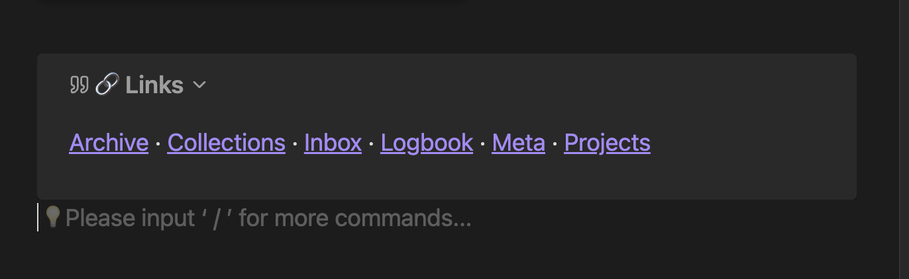
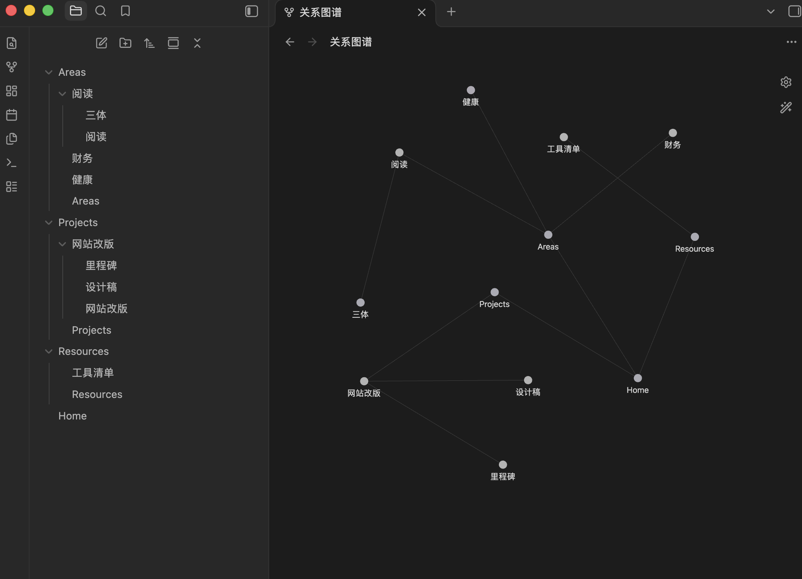

# TreeKeeper

[中文说明](README.zh-CN.md)

Keeps the link callout at the tail of your folder notes in order — so your folder tree shows up in the graph view, and you never hand-maintain a MOC link list again.

## What it does

If you organize your vault as a folder tree with a folder note per folder (a MOC note named after its folder, or any `{{folder_name}}` pattern you like), TreeKeeper makes every folder note link to its children automatically.

Each folder note gets a small callout at the very end, like this:

```markdown
> [!quote]- 🔗 Links
> [[Books]] · [[Film]] · [[Games]] · [[Music]]
```



The links are real wikilinks, kept in dictionary order, and they are live:

- create a note → it's linked into the nearest folder note right away
- delete it → the link disappears
- rename or move it → the links follow
- folder notes themselves link to *their* parent folder notes, all the way up to the root

So the whole tree is connected: every note can climb back to its root through the callouts, and the graph view shows a clean skeleton that mirrors your folders. No dataview trickery here — these are plain `[[links]]`, so backlinks, outgoing links, and the graph view all see them for what they are.



All of this is automatic: TreeKeeper organizes the structure with plain wikilinks, and keeps it in sync as you add, delete, or move notes.

## Who it's for

- you use the [Folder Note](https://github.com/xpgo/obsidian-folder-note) plugin, or the folder-note convention in general
- you organize knowledge as a tree of MOCs — domains, subdomains, projects
- you want the graph view to actually mean something

TreeKeeper and Folder Note pair well: Folder Note opens a folder as its note, TreeKeeper keeps the links between those notes alive. Both support the "inside the folder" and "outside the folder" styles, so the two plugins can agree on where your folder notes live.

## What you can customize

Everything about the block is yours:

- **icon** — the emoji in the title, default `🔗`, can be empty
- **title** — the text after the icon (`Links` in the example above)
- **callout type** — quote, note, tip, whatever Obsidian knows
- **folded by default** — collapsed, expanded, or not foldable
- **folder note naming** — inside the folder or outside it, with a template like `MOC_{{folder_name}}`, or a plain static name
- **blacklist** — folders whose contents stay out of the index (inbox, logbook, whatever you like)

Each block carries a hidden ownership marker (`%% tree-keeper %%`) in its title. You never see it in reading view, and it lets the plugin recognize its own blocks no matter how you restyle them — so changing icon or title later never orphans anything.

Style changes apply to new writes immediately, and the **Apply to all callouts** button restyles every existing block in one go.

## Commands

All under the "TreeKeeper" section in the command palette:

- **Fix MOC links (minimal writes)** — the workhorse: makes the whole vault converge, only touching files that actually need a change
- **Sync all MOC links (rebuild)** — same result, brute force
- **Check duplicate links / Check wrong links / Check missing links / Check all** — read-only audits with a console report
- **Clean blacklisted folders' callouts** and **Remove duplicate links** — targeted cleanups

A note on sync tools: if you use Obsidian Sync (or any file sync) with TreeKeeper enabled on multiple devices, be aware that the plugin writes to your files — concurrent edits on two devices could in rare cases end up as a sync conflict. TreeKeeper adapts to this (it detects sync batches and defers its work until they settle, and its writes are deterministic), but no plugin can fully guarantee conflict-free multi-device writes. Keeping maintenance commands on a single device keeps the risk close to zero.

[Waypoint](https://github.com/IdreesInc/Waypoint) takes a similar idea in a different direction — recursive lists of a folder's contents instead of the tree skeleton. Both write real wikilinks, so pick whichever matches how you think.

## Installation

Coming to the community directory soon. Until then: download `main.js` and `manifest.json` from the [latest release](https://github.com/iLoner121/TreeKeeper/releases) and drop them into `Vault/.obsidian/plugins/tree-keeper/`.

## License

[MIT](LICENSE)
